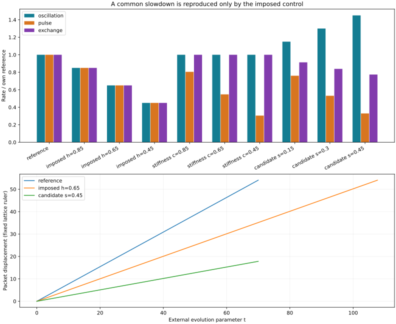

# ClockfieldRedux

**Can different physical clocks agree on a local rate of time?**

This repository contains a runnable, conservative wave-lattice experiment, three clock measurements, controls, and recorded results. It tests a prerequisite for a clockfield interpretation: whether changes in one medium affect different timing mechanisms by the same factor.

The first result is a useful negative: **the tested parameter changes do not produce a universal slowdown.** A deliberately imposed common multiplier does, confirming that the instruments can recognize agreement. This is a linear toy model, not a derivation of gravity.



## Run it

Python 3.10+; CPU only. From this repository's directory:

```bash
python -m pip install -r requirements.txt
python -m unittest discover -s tests -v
python run_experiment.py
```

Open `results/report.html` in a browser after running, or read [the recorded table](results/SUMMARY.md) directly on GitHub. The HTML is self-contained and works offline. Use `python run_experiment.py --out my_run` to preserve the committed example results.

The script writes raw measurements and validation checks to `results.json`, a readable summary, an SVG plot, and the HTML report. No dataset, account, model download, or GPU is required. A run takes seconds to tens of seconds depending on hardware.

## Why compare clocks?

A slow wave is not automatically evidence that all physical processes experience slower time. A medium can slow propagation while leaving an oscillator unchanged, or making it faster. A common effective time requires agreement across mechanisms, in a specified regime and with specified rulers.

Entropy exchange may provide an operational internal clock, but zero entropy change need not mean zero motion. This experiment therefore begins with directly observable oscillations, coherent exchange, and propagation. It does not equate particle current with entropy production.

The motivation includes Barontini's [cold-atom relational-time experiment](https://arxiv.org/html/2509.07745v3) and the broader [analogue-gravity programme](https://arxiv.org/abs/gr-qc/0505065). The model here is not a reproduction of that experiment. All reported numbers come from this repository's classical lattice.

## A declared conservative substrate

Two fields A and B live on the same periodic one-dimensional lattice. Each has a canonical momentum. All quantities are dimensionless; the lattice circumference is L=128.

The Hamiltonian is

$$
H=\frac{h\,\Delta x}{2}\sum_j\left[\sum_{a=A,B}\left(|p_{a,j}|^2+m^2|q_{a,j}|^2+c^2\left|\frac{q_{a,j+1}-q_{a,j}}{\Delta x}\right|^2\right)+\kappa|q_{A,j}-q_{B,j}|^2\right].
$$

Hamilton's equations are $\dot q=hp$ and $\dot p=-hKq$, where K is the stiffness operator implied by the energy. Complex fields in the implementation represent two independent real copies; they allow clean travelling-wave and beat-envelope preparation. This is not quantum entanglement.

- **m** sets the on-site restoring frequency.
- **c** sets spatial stiffness and affects propagation.
- **κ** couples the two components.
- **h** multiplies the entire Hamiltonian. It is an explicitly imposed common-rate control, never an emergent field.

For homogeneous parameters, symmetric and antisymmetric Fourier modes diagonalize the lattice. Their unscaled frequencies obey

$$
\omega_+^2=m^2+\frac{4c^2}{\Delta x^2}\sin^2(k\Delta x/2),\qquad
\omega_-^2=\omega_+^2+2\kappa.
$$

The solver evolves these modes exactly in time and transforms back to fields. There is no explicit-diffusion instability or integration timestep to tune. Spatial discretization and finite observation sampling still require convergence checks.

## Three independent readouts

| Clock | Preparation | Measurement |
|---|---|---|
| Oscillation | Uniform symmetric field, initially at rest | Upward zero crossings of the real field |
| Exchange | Uniform excitation in A, positive-frequency preparation of both branches | Zero crossings of the A-minus-B intensity imbalance |
| Pulse | Symmetric Gaussian packet, width 8, carrier k=π/2 | Slope of its unwrapped circular intensity centroid, divided by L |

The pulse result is an **inferred circulation rate** using a fixed lattice ruler. It is not a measured mirror round trip. The first clock is a spatially uniform mode, not a localized bound object. These choices isolate instrument validation from the harder construction of material clocks and rulers.

Rate estimators use the evolved signals rather than substituting analytic frequencies. The analytic solution is used to evolve the declared Hamiltonian and prepare the probes. The tests independently check the uniform-clock formulas, pulse group velocity, energy conservation, and time reversal.

## What was tested

[PROTOCOL.md](PROTOCOL.md) records the cases and thresholds written before the sweep. This is deterministic validation with known controls, not a blinded discovery trial or a trained model.

Each clock is divided by its own homogeneous reference rate. Agreement means the largest normalized rate divided by the smallest differs from one by less than 1%.

| Example background | Oscillation | Pulse | Exchange | Common rate? |
|---|---:|---:|---:|---|
| Reference | 1.0000 | 1.0000 | 1.0000 | Yes |
| Imposed h=0.65 | 0.6500 | 0.6500 | 0.6500 | Yes, by construction |
| Spatial stiffness c=0.65 | 1.0000 | 0.5474 | 1.0000 | No |
| Candidate m=1.30, c=0.70 | 1.3000 | 0.5316 | 0.8390 | No |

Candidate backgrounds use m=1+s and c=1−s at three declared strengths. These are hypothetical uniform material parameter changes. They are not derived density relations, solitons, or gravitational potentials. Failure rejects a common-rate description for these cases, not every possible substrate.

The physical reason is visible in the dispersion: the oscillation clock tracks the gap m, the exchange clock tracks the difference between the two branch frequencies, and the packet tracks the group velocity. These quantities need not scale together.

## Numerical evidence and limitations

The experiment checks all cases at two observation resolutions. It also checks pulse rates on 256, 512, 1024, and 2048 sites for the reference and strongest candidate. The last refinement must change the pulse rate by less than 1%. The displayed main experiment uses the 256-site lattice; its values are valid discrete-lattice results, not claimed continuum-extrapolated numbers. See [results.json](results/results.json) for exact errors and parameters.

Energy drift is checked against 1e-10 relative. Tests additionally reverse random complex states after evolution. There is no stochastic training, so multiple random seeds are not used as a substitute for convergence analysis.

This version contains no self-supported defect, spatially varying background, moving material ruler, backreaction, nonlinear binding, or entropy-production mechanism. Pulse amplitude is not a probability density; its centroid is an operational envelope readout.

## What would count as progress?

A subsequent model should derive spatial structures and independent probes from a declared substrate, measure their clocks and material rulers, and test agreement across new parameters and mechanisms. Scaling every Hamiltonian term by the same factor can force agreement; that assumption must remain visible.

Only after a common time description survives should propagation and object motion be compared against one consistent effective geometry. Agreement among these three probes alone would still not establish general relativity.

## Files

- `clockfield.py`: Hamiltonian parameters, exact lattice propagator, energy, and clock readouts.
- `run_experiment.py`: sweep, numerical checks, and offline reports.
- `tests/test_clocks.py`: executable physical and numerical checks.
- `PROTOCOL.md`: declared validation criteria.
- `results/`: reproducible measurements and visual report.
